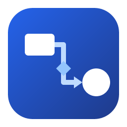
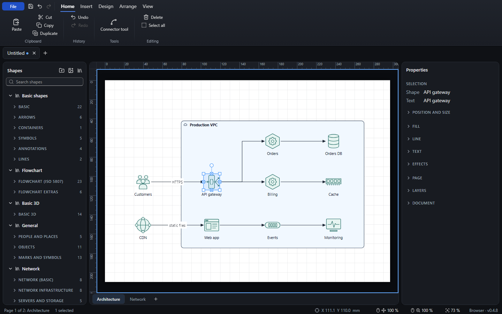

# Sight – beta

Sight is a desktop application for professional diagrams: **flowcharts**, **network and IT
infrastructure diagrams** and **architecture drawings**. It runs natively on Windows, Linux and
macOS.

This repository is for the **beta test**: downloads and problem reports. The source code is not
published here.

## What it can do

- 176 shapes in stencil packs – basic shapes, Basic 3D, ISO 5807 flowchart symbols, general
  icons, network devices and cloud/architecture icons with zones – plus your own SVG, PNG and JPEG
  images as shapes; favourites, folders and search.
- Connectors that stay glued to their shapes, route around other shapes at right angles, take
  bend points, labels, arrowheads and line jumps.
- Styles (fill, line, text, shadow, bevel, gradient), snapping with smart guides, undo and redo
  for every change.
- Several pages per document and layers (visible, locked, printable).
- `.sight` files with autosave: closing never loses work without asking, and after a crash Sight
  offers to restore the unsaved documents.
- Export as SVG, PNG, JPEG and PDF (vector, fonts embedded).
- A ribbon or classic menus; light and dark theme.

Dark theme

What comes next: see the [roadmap](ROADMAP.md).

## Download

Get the installer for your system from the
[latest release](https://github.com/anneuf/Sight/releases/latest) (beta **0.4.13**):

| System | File | Notes |
| --- | --- | --- |
| Windows 10/11 (64-bit) | `sight_0.4.13_x64-setup.exe` | Installs for your user, no admin rights. The installer is not code-signed yet: Windows SmartScreen warns – choose **More info → Run anyway**. |
| macOS 11+ (Apple silicon) | `sight_0.4.13_aarch64.dmg` | Drag Sight to Applications. Signed and notarised by Apple. Intel Macs are not supported by this build. |
| Debian / Ubuntu / Mint (64-bit) | `sight_0.4.13_amd64.deb` | `sudo apt install ./sight_0.4.13_amd64.deb` (pulls in the dependencies). |
| Any Linux (64-bit) | `sight_0.4.13_amd64.AppImage` | `chmod +x` the file and run it; no installation. |

**Updates:** Sight looks for a new version a few seconds after start and installs it when you agree
(Windows, macOS, AppImage; for the `.deb` it opens the release page). You can turn the check off in
About. The `.sig`, `.app.tar.gz` and `latest.json` files in a release are for this updater – you
don't need to download them. Checksums: `SHA256SUMS.txt` (`sha256sum -c SHA256SUMS.txt`).

Sight needs no account and sends no usage data; besides the update check it works offline.

## Reporting problems and ideas

In Sight, **Help → Report a problem** (File menu in the ribbon) opens a problem report here with
your version and system filled in. Or open a new [issue](https://github.com/anneuf/Sight/issues/new/choose)
yourself – **Problem report** when something does not work, **Idea or wish** for something Sight
should do (better). Please say what you did, what you expected and what happened. **Help → Show
log folder** opens the folder with `sight.log`; its last lines help with crashes and errors (it
holds no diagram content). A small `.sight` file that shows the problem helps a lot – but please don't
attach diagrams with content you consider private.

Issues are worked on by priority (`priority: high`, `medium`, `low`; `tbd` = still to be
decided).

## Licence

MIT – see [LICENSE](LICENSE). PDF export embeds the Liberation fonts (Liberation Sans, Serif and
Mono, version 2.1.5), licensed under the [SIL Open Font License 1.1](https://openfontlicense.org/).
