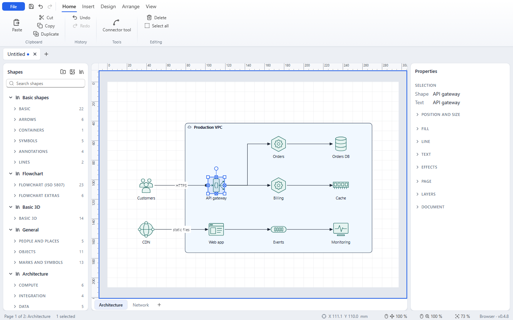

# Sight – beta

Sight is a desktop application for professional diagrams: **flowcharts**, **network and IT
infrastructure diagrams** and **architecture drawings**. It runs natively on Windows, Linux and
macOS.

This repository is for the **beta test**: downloads and problem reports. The source code is not
published here.

## What it can do

- 176 shapes in stencil packs – basic shapes, Basic 3D, ISO 5807 flowchart symbols, general
  icons, network devices and cloud/architecture icons with zones – plus your own SVG, PNG and JPEG
  images as shapes; favourites, folders and search.
- Connectors that stay glued to their shapes, route around other shapes at right angles, take
  bend points, labels, arrowheads and line jumps.
- Styles (fill, line, text, shadow, bevel, gradient), snapping with smart guides, undo and redo
  for every change.
- Several pages per document and layers (visible, locked, printable).
- `.sight` files with autosave: closing never loses work without asking, and after a crash Sight
  offers to restore the unsaved documents.
- Export as SVG, PNG, JPEG and PDF (vector, fonts embedded).
- A ribbon or classic menus; light and dark theme.

Dark theme

What comes next: see the [roadmap](ROADMAP.md).

## Download

The first beta release (**0.4.13**) is being prepared. Installers will appear under
[Releases](https://github.com/anneuf/Sight/releases/latest):

| System | Package |
| --- | --- |
| Windows 10/11 (64-bit) | setup program, installs for your user |
| macOS (Apple silicon) | disk image, signed and notarised by Apple |
| Debian / Ubuntu / Mint (64-bit) | `.deb` package |
| Any Linux (64-bit) | AppImage, no installation |

Sight works offline; it needs no account and sends no usage data.

## Reporting problems and ideas

In Sight, **Help → Report a problem** (File menu in the ribbon) opens a problem report here with
your version and system filled in. Or open a new [issue](https://github.com/anneuf/Sight/issues/new/choose)
yourself – **Problem report** when something does not work, **Idea or wish** for something Sight
should do (better). Please say what you did, what you expected and what happened. **Help → Show
log folder** opens the folder with `sight.log`; its last lines help with crashes and errors (it
holds no diagram content). A small `.sight` file that shows the problem helps a lot – but please don't
attach diagrams with content you consider private.

Issues are worked on by priority (`priority: high`, `medium`, `low`; `tbd` = still to be
decided).

## Licence

MIT – see [LICENSE](LICENSE). PDF export embeds the Liberation fonts (Liberation Sans, Serif and
Mono, version 2.1.5), licensed under the [SIL Open Font License 1.1](https://openfontlicense.org/).
